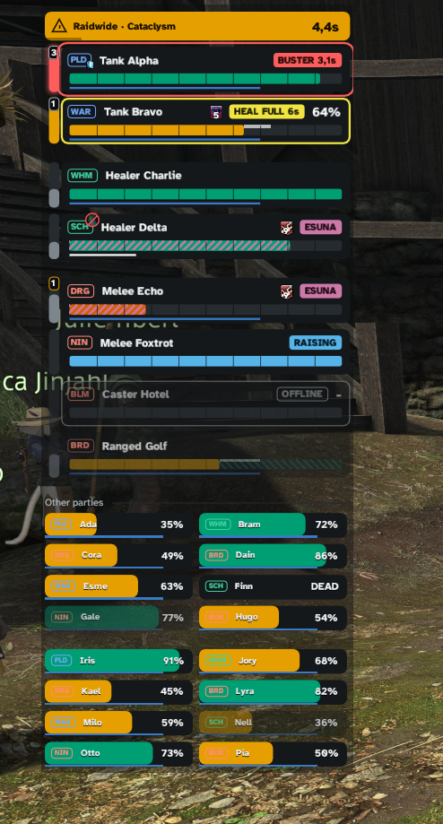
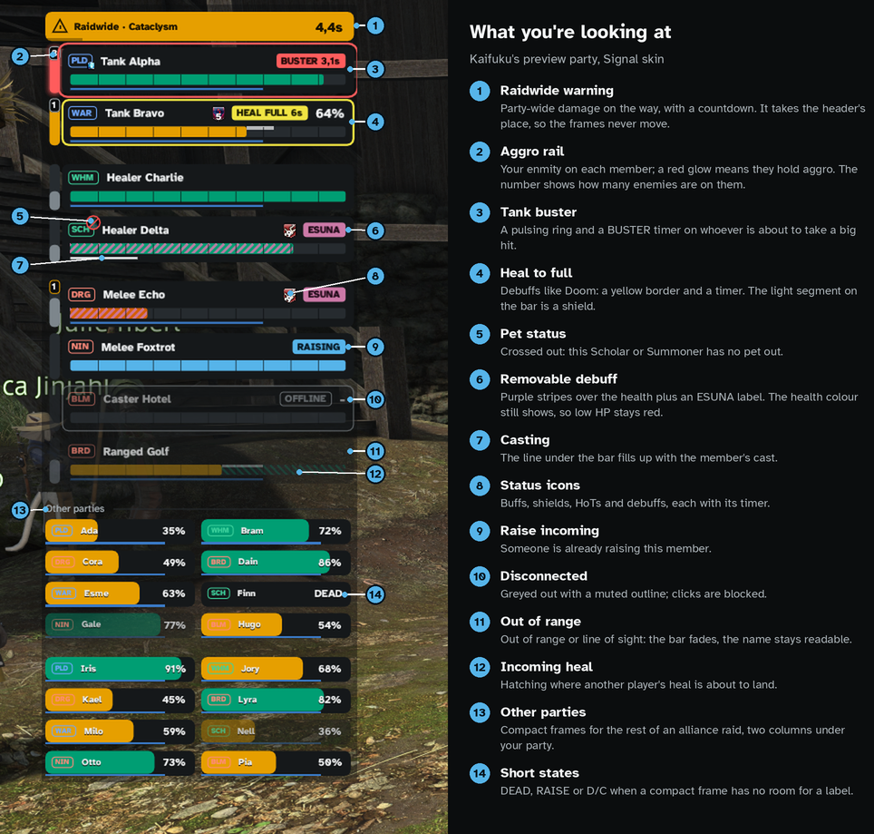
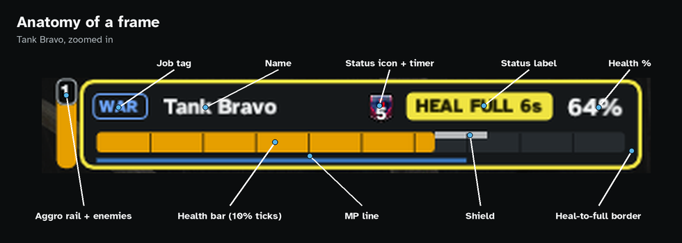
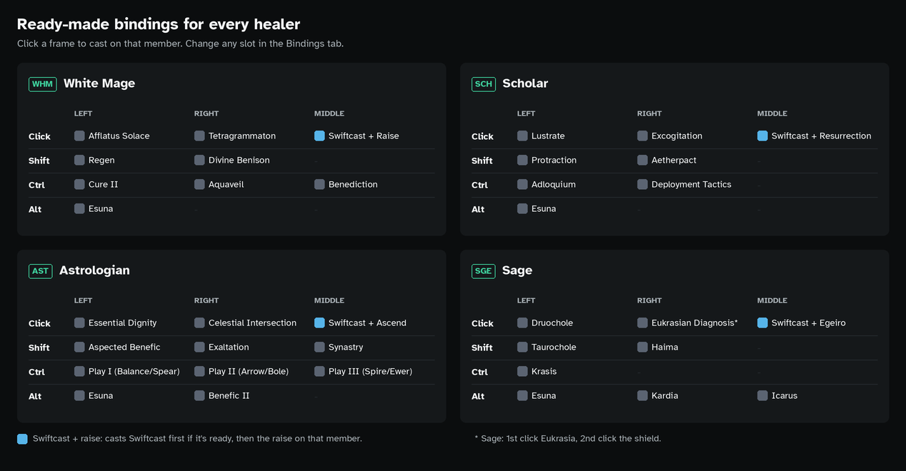

# Kaifuku (回復)

HealBot-style click-to-heal party frames for Final Fantasy XIV, as a Dalamud plugin.
*Kaifuku* means "recovery" in Japanese. Formerly known as HealFrames.

<p align="center">
  
</p>

## Install

1. In game, type `/xlsettings` and open the **Experimental** tab.
2. Under **Custom Plugin Repositories**, paste this URL, click **+**, make sure its checkbox is ticked, then **Save and Close**:

   ```
   https://raw.githubusercontent.com/Gompex/DalamudPlugins/main/repo.json
   ```

3. Type `/xlplugins`, search for **Kaifuku** in **All Plugins** and click **Install**.

Updates install automatically, like any other plugin. The same repo also lists my other plugins.
Kaifuku isn't in Dalamud's main plugin list because it acts in combat (each click casts one action), so it lives in this custom repo.

## What you see

Everything a healer needs to react to, on one frame per party member:



## Anatomy of a frame



## Click to heal

Every healer starts with ready-made bindings: click a frame to cast on that member, and hold Shift, Ctrl or Alt (or use mouse buttons 4 and 5) for more skills. Change any slot in the **Bindings** tab; the binding guide window shows what each click does, with cooldowns.



Tanks and other jobs with ally skills get sensible defaults too (for example Intervention, Nascent Flash, The Blackest Night, Heart of Corundum, The Warden's Paean, Closed Position, Vercure and Swiftcast + Verraise), and you can bind your own game macros with the clicked member as `<mo>`.

**One click always casts exactly one action.** Kaifuku never chooses a target or a skill, and never acts on its own.

## Commands

| Command | What it does |
|---|---|
| `/kaifuku` | Show or hide the frames |
| `/kaifuku config` | Open the settings |
| `/kaifuku guide` | Show or hide the binding guide |
| `/kaifuku lock` | Lock or unlock the frames |

## Make it yours

- **Skins:** Ledger, Heraldry and Signal (colour-blind friendly), plus the Classic look, each with colour variants.
- **Plugin scale** from 75% to 250%, for high-resolution screens.
- **Profiles** that switch automatically per job or content (dungeon, trial, raid, alliance raid).
- **Preview party** to tune everything while solo.
- Alliance raids show which alliance you're in (A, B or C) and compact frames for the other two parties.

## License

Kaifuku is licensed under the GNU AGPL-3.0 (see LICENSE). Bundled fonts are under the SIL Open Font License (see Kaifuku/Fonts).
